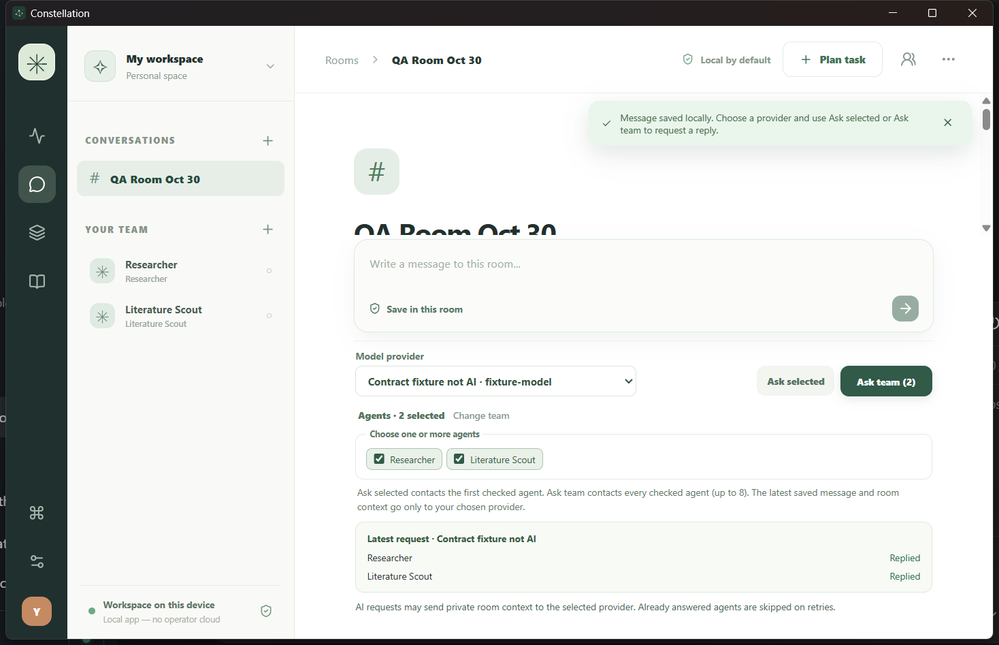

# ✳ Constellation — Your AI team. Your machine. Your rules.

**A local-first workspace for collaborating with multiple AI agents.**



The screenshot is from a real Windows Tauri/WebView2 development build. The
two-agent response test used a deterministic localhost fixture, **not an AI
model**, and is documented with [actual Windows GUI evidence](docs/qa/windows-native-smoke.md).

> **Development status: functional prototype, not a production release.** The
> requested 200 role definitions are present, while the 200 vetted development integrations,
> secured coding execution, Android APK, remote runner, encrypted sync,
> cross-platform installers, full platform testing, and public releases have
> **not** been delivered. An experimental local Windows NSIS installer was
> built and tested separately; no production installer has been published. Do not
> expose private files, credentials, or high-risk workflows to this prototype.

## What is implemented

- A custom Tauri 2/Svelte 5 desktop UI featuring Home, Rooms, Tasks,
  **Evidence**, a **200-template prompt-only Role Library** and Settings. Chat and role creation are
  directly backed by the Rust engine.
- **Explicit, attributed team chat:** save a message locally first, then choose
  a model provider and ask one or up to eight selected agents. Per-agent
  success/partial-failure is visible; retry skips already-saved responses.
- Each agent may be assigned a preferred provider in **Settings**. Rooms can
  explicitly select **Use each agent's saved model** to route different agent
  replies to different compatible endpoints, with truthful per-agent
  results. Saving a preference never sends room context.
- Optional **Test text chat** in Settings performs one explicit bounded
  request using the selected provider protocol (OpenAI Chat, Responses,
  Anthropic Messages, Gemini, native Ollama or custom-compatible).
  Its status only verifies the text-response contract, not tool
  calling, streaming, or other model capabilities; a remote API may charge
  for the test.
- **Opt-in experimental streaming replies:** Rooms can show provisional live
  text previews from OpenAI Chat/compatible, Responses, Anthropic or native
  Ollama endpoints. Native HTTP streaming and SQLite-safe final persistence
  passed private localhost fixtures across five protocol variants. A stream
  that fails after emitting text does **not** save a reply. Live-provider
  support and installed GUI streaming are not yet certified. **Stop live
  response** interrupts the room's in-flight stream and prevents further
  individually routed agents from being contacted; replies completed before
  cancellation remain saved. Gemini uses the established nonstreaming path.
- **Explicit text-only task runner:** record a task, choose a model, and run
  it on demand. The model's result is stored in the room with an atomic
  succeeded task state. Cancellation interrupts an in-flight response, and
  restarts mark unverified requests failed. Automated coding loops and process
  execution remain unavailable in the desktop app.
- **Independently reviewed local file actions (experimental):** pending tasks can
  prepare a text-file read or create a *new* text file (16 KiB maximum) inside
  the application's private `local-file-artifacts` directory. The native host
  validates the task, path and exact operation, then displays a read/write
  preview before a separate user confirmation. An accepted action consumes
  one approval and creates an authenticated local journal receipt; rejection,
  modified digests and replay cannot execute. Credentials for the audit
  journal are stored in the supported OS credential manager and do not fall
  back to plaintext. A new **Ask model for a file proposal** button explicitly
  sends only this task's instructions to the selected provider and accepts one
  strictly parsed JSON suggestion for a bounded read/create action. Invalid
  JSON and attempted privilege claims are rejected; the provider response
  cannot authorize anything. Every suggestion still requires independent
  native approval. Reading a path first requires native permission to inspect
  the lexical file name before any size/hash/file access, followed by a second
  native SHA/byte-count confirmation before the read is dispatched. Model
  requests are user initiated and charged against **durable SQLite limits of
  16 attempts per task and 128 per configured provider ID**, including errors
  and cancellations. These are request-count limits, not a monetary spend cap;
  requests are not automatically retried. **No model may
  approve its own action, access arbitrary filesystem paths, run a process,
  invoke Git, or automatically send read contents to an external provider.** On
  Windows, a separate native
  review window now displays the exact prepared operation and scrollable
  source/hexadecimal content; only a native Yes creates a sealed, one-use
  consent proof. The model suggestion path has source-level tests; its
  **installed GUI acceptance** and true iterative coding remain open. The
  dialog is not a secure-desktop attestation or hardened OS sandbox.
- Copy a single room's attributed transcript as Markdown without sending it to
  a model or writing a file silently.
- **Evidence search:** paste one text/Markdown document (up to 128 KiB) and
  search locally with bounded lexical retrieval. Every displayed quotation is
  checked against the original UTF-8 byte span and labeled with its source
  checksum. Copy the verbatim passage and provenance in one click. This is
  offline retrieval, not a model-generated RAG answer or durable document library.
- **Tasks → Workflows:** build a one-to-three-step research → writing → review
  plan with individually chosen agents, providers and instructions. Native Rust
  validates dependencies, saves a versioned SQLite workflow, and exposes
  explicitly triggered text-step execution. Run individual ready steps or
  up to three dependency-ordered steps with the assigned provider; each
  request may incur provider charges. Successful bounded results persist
  atomically with step completion and become labeled untrusted context for
  successors. Restart blocks uncertain attempts; cancellations reject late
  results and retries require a separate decision. Preview, save and cancel
  send no model requests. No autonomous device tool execution or schedule
  exists. See [workflow details](docs/workflows.md).
- A fully Rust-owned persistence crate (`crates/constellation-core`) with
  SQLite WAL, event-atomic changes, typed IDs, rooms, agents, messages, task
  state transitions, and idempotent operation IDs.
- A default-deny scope-aware Rust permission policy and experimental
  tool library with exact-scope approvals, digest binding and durable
  authenticated receipts. Only manually approved reads and create-new writes
  in the private artifacts directory are wired into the desktop. Standalone
  process/Git tool implementations are never exposed to agents, and Windows
  Job Object cleanup alone is **not** a verified OS sandbox.
- An Argon2id/AES-256-GCM encrypted backup and recovery flow in **Settings →
  Advanced Studio**. **Full project archive** creates one encrypted
  `.cstlproj` file containing independently verified online snapshots of the
  studio and workflow SQLite databases (including committed WAL data). Recovery
  authenticates both images before publishing a new directory containing
  `studio.sqlite3` and `workflows.sqlite3`; the active workspace is never
  replaced. Each DB is consistent individually, but there is no application
  barrier making concurrent writes across both DBs one atomic snapshot.
  Previous `.cstlbkp` studio-only backup/recovery remains available separately.
  File attachments, automatic activation/migration, scheduled backup and
  cloud sync remain open.
- **Native six-protocol provider layer:** OpenAI Chat, OpenAI Responses,
  Anthropic Messages, Google Gemini, Ollama native and user-configured
  OpenAI-compatible endpoints. Remote HTTPS or explicit
  loopback HTTP. API keys stay in RAM by default; on supported Windows/macOS
  accounts, users may explicitly opt into their OS credential manager, with
  no plaintext fallback. The desktop sends context only when the user
  explicitly requests Ask, Run or Test (the last may also incur provider charges).
  The explicit Test text chat probe and actual Ask/Run path share a constrained
  HTTP destination validator, DNS pinning and proxy/redirect restrictions.
  A text response alone does not certify arbitrary provider features,
  live-provider compatibility or provider-side privacy.
- **Offline encrypted sync protocol and opt-in S3 HTTPS adapter:** a standalone
  Rust crate validates authenticated revisions, immutable encrypted snapshots,
  conditional-only writes and two-writer conflicts. Its path-style S3 adapter
  signs HTTPS requests and fails closed where a provider cannot demonstrate
  conditional compare-and-set semantics. Local adversarial fixtures pass, but
  **real-service CAS, two-device restore, native sync UI and remote credentials
  have not been verified**.
- A standalone **encrypted SQLite backup/restore CLI** in
  `crates/constellation-backup-cli` uses a consistent SQLite online snapshot
  (including committed WAL records), Argon2id/AES-256-GCM and authenticated
  recovery with no-echo console passphrases. It is independently tested; the
  desktop app's attachment recovery and cloud sync are not implemented yet.
  See the [offline backup instructions](crates/constellation-backup-cli/README.md)
  and [two-database project archive contract](crates/constellation-project-backup/README.md).
- An offline system-font, compact and responsive interface with keyboard
  navigation, paginated chat history and a disabled browser-only preview.

## Install and explore

**Windows x64:** A locally built, **unsigned experimental** NSIS installer is
generated at
`apps/desktop/src-tauri/target/release/bundle/nsis/Constellation_0.1.0_x64-setup.exe`
when `pnpm tauri build --bundles nsis` completes. That local file is not a
verified public download. Cross-platform installation packages and release
links do **not** exist yet. The latest validation/installer identity is recorded
in [native QA](docs/qa/windows-native-smoke.md).

Begin with the illustrated-style [getting-started guide](docs/getting-started.md)
and [provider/privacy notes](docs/providers.md). You can create a room and save
messages **without a model account**; remote inference may cost money and sends
the chosen room content to the remote provider.

To run a task, visit **Tasks**, create a plan assigned to an agent, select the
configured model in **Model for task execution**, then press **Run text task**.
You can also choose the task agent's saved model preference.
The selected model receives the task instructions only. It cannot operate on
your files or run processes through this feature. A real installed Windows
fixture exercise is recorded in [native QA](docs/qa/windows-native-smoke.md).

For a manual local file action, expand **Review a local file action** on a
pending task. Choose read or create, enter a path relative to the application's
private artifacts directory, preview the exact file and contents, then press
**Approve this exact file action** or **Reject without executing**.
The path preview is absolute so you can inspect which directory is affected.
Each approval is consumed once. To request a provider-generated suggestion,
select a model and click **Ask model for a file proposal** on a pending task.
Review the proposed content and the independent native consent dialog, then
approve or reject. Model output alone cannot grant access or execute actions.

## Develop

Prerequisites: Rust stable (MSVC on Windows), Node.js, Windows C++ Build Tools
and WebView2 on Windows. Other platforms require their documented Tauri system
dependencies. **Building the UI does not require a model account.**

```sh
cd crates/constellation-core
cargo test

cd ../constellation-tools
cargo test

cd ../../apps/desktop
pnpm install --frozen-lockfile
pnpm run check
pnpm tauri dev
```

If the D: volume lacks space for Rust debug binaries, relocate **only this
build's output** on Windows PowerShell before launching from `apps/desktop`:

```powershell
$env:CARGO_TARGET_DIR = Join-Path $env:LOCALAPPDATA 'Temp\constellation-cargo-target'
$env:CARGO_INCREMENTAL = '0'
pnpm tauri dev
```

The current project has not undergone a production security audit.

## Architecture

```text
apps/desktop/src       Svelte / view only, no direct shell permissions
apps/desktop/src-tauri Native command boundary and network request dispatcher
crates/constellation-core  Rust persisted state, provider request preparation,
                           task state machine, policy evaluation
crates/constellation-tools Exact-scope local read/write/process/Git operations;
                            only reviewed private file reads and create-new
                            writes wired to native app; OS sandbox still open
catalog/                  200 distinct prompt-only role instructions and tests
skills-manifest/          Truthful inventory; seven source-pinned offline
                           audit exercises at last verified fixed-input run,
                           strict credit can change with source edits
docs/                   Provisional architecture comparison, security and QA
assets/                 Original source vector emblem
```

Documentation:

The development repository excludes certain host-specific historical QA
receipts, private screenshots and internal working notes. References to those
records are descriptive only, not independently downloadable release evidence.
The tracked acceptance ledger records the remaining verification requirements.

- [Architecture decision](docs/architecture-decision.md)
- [Acceptance ledger](docs/quality/acceptance-ledger.md)
- [Active delivery task plan and completion blockers](docs/mission/COMPLETE_EXECUTION_PLAN.md)
- [Initial threat model](docs/security/initial-threat-model.md)
- [Native Windows GUI smoke evidence](docs/qa/windows-native-smoke.md)
- [Getting started](docs/getting-started.md)
- [Provider and privacy boundaries](docs/providers.md)
- [Agent and local file approval guide](docs/agents-and-tools.md)
- [Implementation roadmap](docs/roadmap.md)
- [Development tool evidence inventory](skills-manifest/README.md)
- [Mission checkpoint](docs/mission/status.md)

## Safety and limits

No arbitrary shell, filesystem modification, browser control, MCP tools,
auto-delegation, sync or remote runner is enabled. The desktop app can open
without a provider. Provider errors do not falsely mark tasks complete.
Running as the local user is **not** itself a security sandbox; a tested OS
containment layer must precede actual high-privilege coding tools.

**Licensing:** Repository license selection and dependency redistribution
review are pending. Do not publish an installer or copy the branding without
the final license review.
